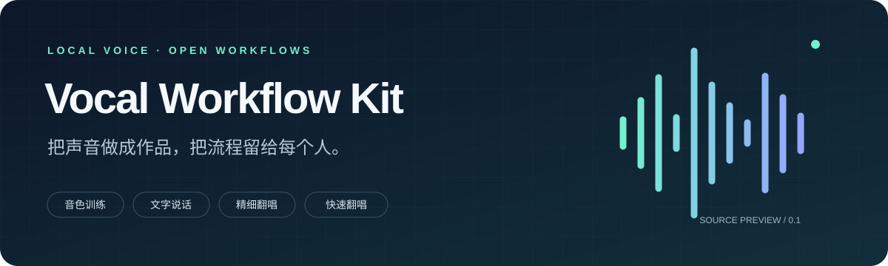
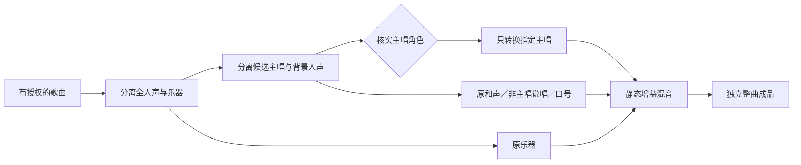

<div align="center">



# Vocal Workflow Kit

**把声音做成作品，把流程留给每个人。**

本地音色训练 · 文字说话 · 精细翻唱 · 快速翻唱

`LOCAL FIRST`　 `AI FRIENDLY`　 `NO BUNDLED VOICES`　 `MIT`

[快速开始](#五分钟了解项目) · [交给你的 AI](AI_HANDOFF.md) · [项目主页](docs/index.html) · [完整文档](docs/INDEX.md)

</div>

---

> **不会配置？懒得折腾？直接把本仓库链接丢给你的 AI。** 请它先阅读 [AI 接手说明](AI_HANDOFF.md)，再帮你配置、测试和修 bug。DSH 或其他 AI 需要具有相应的本地工具能力。

GitHub 上的这份 README 就是仓库首页。另附静态展示主页；启用 GitHub Pages 时请选择分支 **/(root)**，操作见 [GitHub 发布说明](docs/github-publishing.md)。

## 先选对路线

| 你想做什么 | 使用路线 | 本项目提供 |
|---|---|---|
| 让自己的声音自然说话 | GPT-SoVITS：文字 → 语音 | 训练指南、API v2 适配器、本地服务自检 |
| 训练用于歌曲换声的音色 | RVC：训练语料 → 权重＋检索索引 | 数据体检、训练计划生成、检查清单 |
| 认真做一首翻唱 | 两阶段分离 → 主唱角色确认 → RVC → 保留原背景混音 | 可配置精唱入口、冻结音高轨、来源校验 |
| 快速试一段效果 | 单阶段分离 → RVC → 混音 | 独立快速入口、较轻的分离设置 |

**讲话模型和唱歌模型不能互换。** RVC 不是文字转语音，也不负责从零作曲；让 TTS 念歌词不等于唱歌。

> 这是通用工具与流程层，不是装好全部模型的整合包。音色、训练语料、歌曲和模型权重均由使用者自行准备。项目没有附带任何真实声音样本、账号或聊天内容。

## 五分钟了解项目

### 1 · 本地准备

需要 Python 3.10+、FFmpeg，以及分别安装的 RVC / MSST / GPT-SoVITS（按需选择）。不同上游版本使用独立环境；**不要把它们的全部依赖装进同一个 Python**。

```powershell
python -m venv .venv
.venv\Scripts\python -m pip install -e ".[audio]"
Copy-Item config.example.json config.local.json
```

macOS / Linux 对应使用 `.venv/bin/python` 和 `cp`。根据实际安装位置编辑 `config.local.json`；它已经被 Git 忽略。

### 2 · 先做诊断，再运行

```powershell
python -m vocal_workflows doctor --json
python -m vocal_workflows doctor --speech --json
python -m vocal_workflows fine --source "input/song.wav" --dry-run
```

缺少模型时，诊断会明确报缺失。`--dry-run` 只打印计划，**不能证明音频已经生成**。

### 3 · 选择你的入口

```powershell
# 数据体检；不会训练
python -m vocal_workflows dataset-audit "datasets/my_voice"

# 生成 RVC 训练命令模板；不会执行
python -m vocal_workflows train-plan --kind rvc --experiment example_voice

# 讲话：使用已配置好音色的本地 GPT-SoVITS API v2
python -m vocal_workflows speak --text "你好，今天也一起做点有趣的事情吧。"

# 快速翻唱：单阶段分离，保留整个分离人声的表现
python -m vocal_workflows quick --source "input/song.wav"

# 精唱：先核实谁是主唱，再明确确认角色
python -m vocal_workflows fine --source "input/song.wav" --roles-confirmed
```

## 精唱，保留的是什么？



主唱可以是男声、女声、说唱或演唱。**按角色分，不按性别或唱法分。** 两阶段模型的标签不等于角色识别；交叠处要听，低音也不等于男声。

默认保留原背景人声。伴奏与背景轨使用相同相对增益，再和转换后的主唱混音。原唱仍提供节奏、咬字和演唱方式，不能保证任意音源都得到相同音色表现。

## 不会配置？懒得折腾？直接丢给你的 AI。

将仓库链接或本地项目目录交给 DSH、Codex 或其他具备本地工具权限的 AI，附上：

> 请先读 `AGENTS.md`、`AI_HANDOFF.md` 和 `docs/compatibility.md`。先诊断并给出缺失项，再在我的授权范围内配置本地依赖。不要上传文件、启动训练或关闭其他程序。用测试和真实输出分别验收；修 bug 前备份，保留已有模型与分离结果。

- `AGENTS.md`：项目级协作约定与修复边界。
- `skills/vocal-workflows/SKILL.md`：可供 DSH / AI 读取的通用技能。
- `doctor --json`：机器可读的依赖存在性检查。
- `tests/`：不需要真实声音或 GPU 的回归测试。
- `support-bundle`：仅打包脱敏诊断，不打包配置、音频、权重或日志。

AI 有无安装和执行能力取决于其宿主权限。**读到技能文件不等于自动安装了 MCP 工具，也不等于获得系统权限。**

## 文件，各归其位

```text
vocal-workflow-kit/
├─ README.md / AGENTS.md / AI_HANDOFF.md
├─ config.example.json       # 只有通用示例
├─ vocal_workflows/          # 原创流程层与上游适配器
├─ docs/                     # 训练、说话、精唱、快唱与静态主页
├─ prompts/                  # 可复制的通用任务提示词
├─ skills/                   # AI 读取说明
├─ tests/                    # 合成数据与替身测试
└─ scripts/                  # 白名单打包与发布检查

workspace/                   # 运行时创建，永不进入发布包
├─ runs/<独立编号>/           # 中间音轨、报告、日志
├─ finished/                 # 平铺的整曲 MP3
└─ speech/                   # 讲话 WAV 与简要回执
```

已有合格分离可用 `--reuse path/to/manifest.json` 复用；工具会核对同源、模式和音轨哈希。旧结果不覆盖。当前版本**不提供自动续训、自动重放中断推理、持久优先队列或关闭其他软件的能力**；同工作区的翻唱采用互斥，未完成任务需先核对。

## 当前验证范围

| 层级 | 本包如何验证 |
|---|---|
| 计划、参数、数据体检 | 标准库单元测试 |
| 阶段编排、错误与复用 | 替身上游测试，不加载音色 |
| 混音、格式 | 临时合成音频测试，需 audio 依赖和 FFmpeg |
| 讲话协议 | 临时本地模拟服务测试，不用真实说话素材 |
| 真实 RVC / MSST / GPT-SoVITS 效果 | **必须在使用者自己的环境、授权音色与音源上验收** |

移植后的通用包不冒充私人环境的逐样本复现。兼容性与已知限制见 [compatibility.md](docs/compatibility.md)。

## 开源，不等于公开你的声音

本项目默认不下载音源、不联网发帖、不发 QQ、不上传音频、不接第三方付费生成接口。公开仓库只收通用源码、文档、测试和示例配置。发布前执行：

```powershell
python scripts/release.py --check
python scripts/release.py --output ../vocal-workflow-kit-public.zip
```

发布脚本采用**路径白名单＋文件类型限制＋敏感模式扫描**；请仍然逐项审阅清单。`.gitignore` 不会替你删除已跟踪的文件，也不能取代发布审核。

本仓库原创内容采用 MIT。上游代码、模型、训练数据、参考录音和歌曲各自遵守原授权；本包不赋予它们新的使用或再分发权利。依赖与来源见 [THIRD_PARTY_NOTICES.md](THIRD_PARTY_NOTICES.md)。
